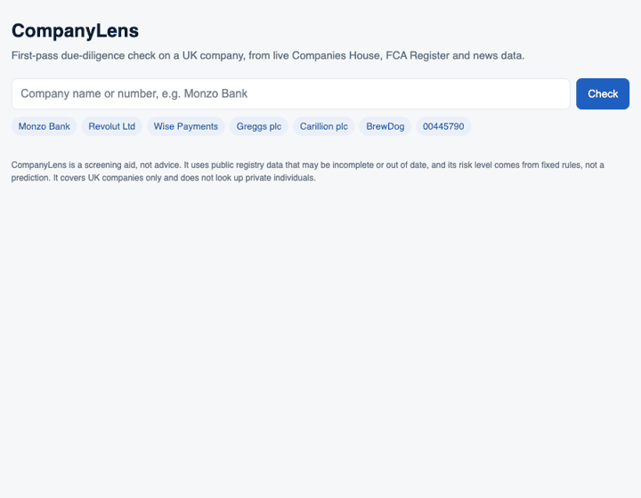

# CompanyLens

An AI agent for first-pass due diligence on UK companies. Give it a company name or number; it queries Companies House (and, once credentials exist, the FCA Register) plus GDELT news, then returns a structured report where every claim cites its evidence.

It is a screening aid, not advice. The risk level comes from fixed rules (R1–R9), not from the model.



## What it does

- Resolves a name or number to one company, asks you to choose when several match, says "not found" when none do, and refuses requests about private individuals.
- Calls tools (profile, officers, PSC, charges, insolvency, filings, FCA, news) in a LangGraph loop with tool-call and round limits.
- Computes the risk level with deterministic rules over the tool output.
- Checks each summary sentence against the evidence (deterministic number/fact check plus an LLM check, one repair attempt, then drops what it cannot support).
- Streams progress over SSE to a static UI; shows 429, 503 and gateway errors with clear messages.
- Exposes the same tools over MCP (`docs/mcp.md`).
- Redacts officer and PSC names, emails and phone numbers in logs and Langfuse traces.

## Known limitations

- **FCA Register check is not live.** The FCA developer portal was unavailable when this was built, so no key is configured. Reports say "FCA credentials not configured" under limitations, and FCA is excluded from every evaluation metric. The endpoint itself is unverified. Re-run just that part later with `python eval/refresh_fca.py`.
- **Ambiguous names are the main weakness.** On the test split the agent returned a report instead of asking which company was meant for 6 of 7 ambiguous queries (`docs/failure_analysis.md`).
- **News coverage is partial.** GDELT rate-limits; only part of the evaluation snapshot has news.
- **No human-approval step.** The state fields exist but the interrupt is not implemented.
- Judge-vs-human agreement is unmeasured: `eval/hand_check.csv` is generated but not yet filled in by a person.
- Costs are estimates from token counts and a price table, not provider invoices.

## Evaluation

Frozen snapshot of tool outputs replayed for every configuration; dev split (n=26) for tuning, test split (n=54) run once. Judge is a different model family (google/gemma-3-27b-it). 95% bootstrap CIs over items. Full tables: `eval/results/summary.md`; method: `docs/eval_method.md`.

Test split, n=54 (intervals are wide):

| Config | Routing correct | Risk matches rules oracle | Flag recall | Reports with ≥1 unsupported sentence | Cost/report (est.) |
|---|---|---|---|---|---|
| Fixed pipeline (no agent) | 74% | 100%* | 100%* | 36% | ~£0.0003 |
| Agent, Qwen3.8-27B | 87% | 91% | 92% | 31% | £0.007 |
| Agent, Qwen3-30B-A3B | 87% | 94% | 92% | 33% | £0.001 |
| Agent, Mistral Small | 87% | 100% | 100% | 17% | £0.001 |
| Agent, no claim check | 87% | 91% | 88% | 33% | £0.007 |
| Agent, 3-tool budget | 87% | 74% | 65% | 71% | £0.002 |

\*The fixed pipeline always calls every tool and uses the same rules as the oracle, so its risk agreement is 100% by construction.

What the numbers support: the agent routes better than the fixed pipeline's naive top-hit resolver (74% → 87%, intervals overlap in places); a small tool budget clearly hurts recall; the claim check made no clear difference on the test split (31% vs 33%, overlapping intervals). They do not show that the agent beats the pipeline on report quality. Prompt injection (E5): 30 of 30 poisoned runs kept the risk level, flags, prompt secrecy and tool budget.

## Run it

```bash
make setup
cp .env.example .env     # add your own keys; never commit .env
make test                # no network, no keys needed
make run                 # http://localhost:8000
```

Docker: `make docker`. Measured under `docker run --memory=512m`: peak 92 MiB, idle 84 MiB, no OOM, cold start 1.4 s (`eval/results/memory.json`).

Environment variables: `COMPANIES_HOUSE_API_KEY`, `NEBIUS_API_KEY`, `MISTRAL_API_KEY`, `LANGFUSE_PUBLIC_KEY`, `LANGFUSE_SECRET_KEY`, `LANGFUSE_HOST`, `DAILY_BUDGET_GBP`, `FCA_API_EMAIL`, `FCA_API_KEY`.

API: `GET /health`, `GET /configs`, `POST /report`, `GET /report/stream?q=...` (SSE). Limits: 10 reports/min/IP, daily budget cap (503 when exhausted).

## Docs

`docs/architecture.md`, `docs/decisions.md`, `docs/safety.md`, `docs/data_and_privacy.md`, `docs/eval_method.md`, `docs/failure_analysis.md`, `docs/mcp.md`.

## Data and privacy

Officer and PSC names (public register) may appear in reports; dates of birth, addresses, nationality and other personal details never do, and the service refuses person-centred searches. See `docs/data_and_privacy.md`.
